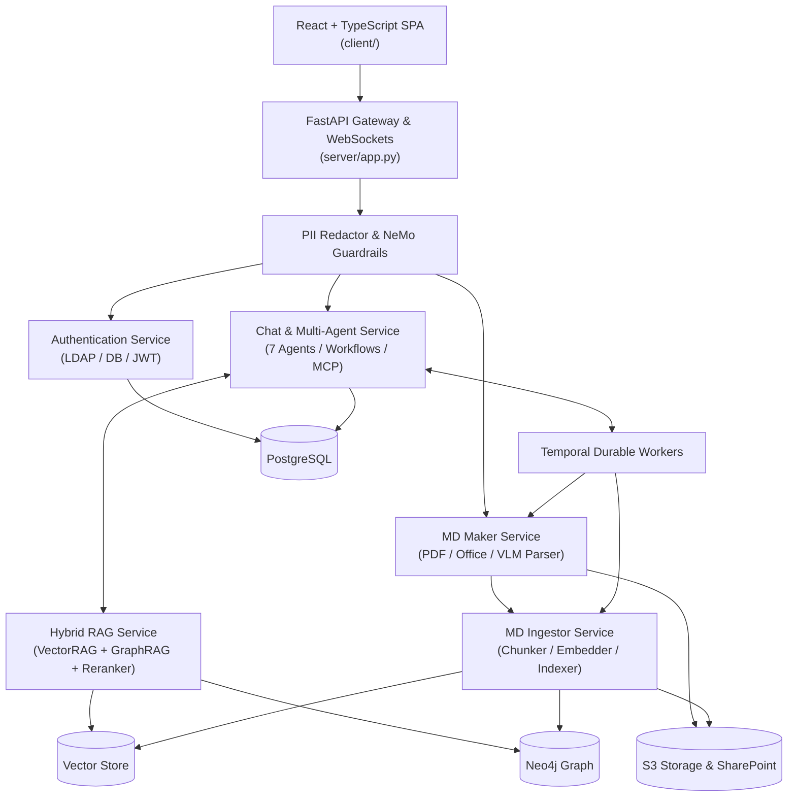

# `ai-multiagents-enterprise-assistant`

**Enterprise Multi-Agent Hybrid RAG & Conversational AI Platform**

`ai-multiagents-enterprise-assistant` is a full-stack, microservices-based Retrieval-Augmented Generation (RAG) and agentic AI system built for regulated enterprise environments. It combines **Hybrid Retrieval** (dense vector search + Neo4j Knowledge Graph traversal + reranking), **multi-agent orchestration** with Model Context Protocol (MCP) tools, **multimodal document ingestion**, **NVIDIA NeMo Guardrails & PII redaction**, **durable Temporal workflows**, and a **white-label React/TypeScript web application**.

---

## Key Features

- **Multi-Agent Orchestration & MCP Tools**: Decomposes complex queries across specialized domain agents (`ChatAgent`, `ResearchAgent`, `AnswerAgent`, `NotesAgent`, `ReportAgent`, `TicketAgent`, and `UserSupportAgent`) with real-time execution trace streaming and sandboxed MCP tool calling.
- **Hybrid Vector + Graph RAG**: Fuses semantic vector similarity (`VectorRAG`) with multi-hop Neo4j Knowledge Graph traversal (`GraphRAG`), pre-retrieval RBAC/metadata filtering, and cross-encoder/LLM reranking.
- **Two-Stage Multimodal Ingestion (`md_maker` + `md_ingestor`)**: Parses PDFs, Office suites (`.docx`, `.pptx`, `.xlsx`), and SharePoint repositories into structured Markdown enriched with VLM/LLM image, slide, and table descriptions before indexing into Vector and Graph stores.
- **Durable Workflow Execution**: Powered by **Temporal** to handle long-running ingestion pipelines, SharePoint syncs, and deep multi-agent research without HTTP timeouts or state loss.
- **Enterprise Security, Privacy & Guardrails**: Supports LDAP/Active Directory and local JWT authentication, automated PII redaction (`pii_redactor`), programmable **NVIDIA NeMo Guardrails**, and document-level RBAC isolation.
- **White-Label & Localized Web Client**: React + TypeScript + Tailwind/Shadcn SPA featuring live agent trace inspection, built-in PDF viewing, token usage forecasting, multi-language support (`en`, `it`, `zh` via Lingui), and white-label tenant builds (`default`, `carraro`, `mirai`, `necto`).
- **Full-Stack Observability**: End-to-end OpenTelemetry instrumentation feeding Prometheus, Loki, Tempo, and pre-provisioned Grafana dashboards.

---

## Architecture at a Glance



---

## Repository Structure

```text
ai-multiagents-enterprise-assistant/
├── client/                     # React + TypeScript + Vite SPA frontend
│   ├── config/                 # White-label tenant configurations (default, carraro, mirai, necto)
│   └── src/                    # Components, API clients, Lingui locales (en/it/zh), routes
├── docker/                     # Dockerfiles, docker-compose.yml & observability stack
│   └── observability/          # OpenTelemetry Collector, Prometheus, Loki, Tempo, Grafana
├── docs/                       # Detailed architecture, API, RAG, security & ops documentation
├── server/                     # Python 3.10+ FastAPI backend & microservices
│   ├── api/                    # Public Gateway routers (/login, /conversation, /ingest)
│   ├── config/                 # YAML service configs, prompts, guardrails & secrets templates
│   ├── scripts/                # Admin utilities (create_user.py, ES-to-Postgres migration)
│   ├── src/
│   │   ├── common/             # Shared DB/S3/SharePoint connectors, LLM managers, privacy, telemetry
│   │   ├── knowledge/          # Vector and Graph knowledge abstractions
│   │   └── services/           # Microservices: authentication, chat, md_ingestor, md_maker, rag, temporal
│   └── tests/                  # Automated Pytest unit & integration suite
└── start-dev.ps1               # Windows local development multi-service launcher
```

---

## Prerequisites

Ensure the following tools are installed on your machine before proceeding:

- **Docker** (`24.0+`) & **Docker Compose** (`v2.20+`) — required for containerized deployment and backing infrastructure (PostgreSQL, Neo4j, SeaweedFS S3, Redis, Temporal, Observability).
- **Python** (`3.10+`) & **[`uv`](https://docs.astral.sh/uv/)** — required for local backend development and running the test suite.
- **Node.js** (`18+` or `20+`) & **Yarn** (`1.22+`) — required for local frontend development and building white-label bundles.

---

## Installation

### 1. Clone the Repository
```bash
git clone https://github.com/95gas/ai-enterprise-assistant
cd ai-multiagents-enterprise-assistant
```

### 2. Initialize Environment & Secret Templates
```bash
# Shared environment for Docker Compose and local PowerShell runs
cp server/config/secrets.env.example server/config/secrets.env
```

### 3. Install Local Dependencies *(Optional — for Local Development)*
If you plan to run the backend or frontend outside Docker:

```bash
# Install Python backend dependencies via uv
cd server
uv sync --locked
cd ..

# Install frontend dependencies via Yarn and apply a tenant profile
cd client
yarn install
cp config/default/.env .env
cd ..
```

---

## Configuration Reference

All runtime behavior, model providers, storage connectors, safety policies, and white-label branding are configurable without modifying source code.

### 1. Secrets & Environment Variables (`server/config/secrets.env`)
Use this single file for local application runs and Docker Compose:
- **LLM & VLM Provider Keys**: API keys and base URLs for OpenAI, Azure OpenAI, or self-hosted vLLM/Ollama endpoints (`OLLAMA_BASE_URL`).
- **Relational & Graph Databases**: PostgreSQL connection credentials (`POSTGRES_DB`, `POSTGRES_USER`, `POSTGRES_PASSWORD`) and Neo4j credentials (`NEO4J_USERNAME`, `NEO4J_PASSWORD`, `NEO4J_DATABASE`).
- **Object Storage & SharePoint**: SeaweedFS / S3 credentials (`S3_ACCESS_KEY`, `S3_SECRET_KEY`) and optional Microsoft SharePoint / Graph API credentials (`SHAREPOINT_TENANT_ID`, `SHAREPOINT_CLIENT_ID`, `SHAREPOINT_CLIENT_SECRET`, `SHAREPOINT_SITE_URL`).
- **Authentication & LDAP**: `JWT_SECRET`, token expiration TTL, and optional enterprise LDAP bind settings (`LDAP_SERVER_URI`, `LDAP_BIND_DN`, `LDAP_BIND_PASSWORD`, `LDAP_BASE_DN`).
- **Temporal & Observability**: Temporal server address/namespace (`TEMPORAL_ADDRESS`, `TEMPORAL_NAMESPACE`) and OpenTelemetry toggles (`OTEL_ENABLED`, `OTEL_EXPORTER_OTLP_ENDPOINT`).

### 2. Backend Service Configurations (`server/config/`)
Each subsystem is tuned through declarative YAML files in `server/config/` (validated at startup by `server/config/settings.py`):

| Configuration File | What You Can Configure |
| :--- | :--- |
| **`server/config/system.yaml`** | Runtime environment (`dev`/`prod`), API Gateway host/port, allowed CORS origins, log levels, and global feature flags. |
| **`server/config/microservices.yaml`** | Internal URLs, ports, HTTP timeouts, retry policies, and service-to-service headers for `authentication`, `chat`, `rag`, `md_maker`, `md_ingestor`, and `temporal`. |
| **`server/config/models.yaml`** | Model providers, model names, temperatures, max tokens, and context limits for **chat LLMs**, **Vision-Language Models (VLMs)**, **dense embedding models**, and **rerankers**. |
| **`server/config/chat.yaml`** | Conversation memory window length, WebSocket streaming intervals, default agent routing rules, and workflow defaults (`default`, `focus`, `example_questions`). |
| **`server/config/ingestion.yaml`** | Semantic chunk size, chunk overlap, allowed MIME types/file extensions, VLM image/slide/table description toggles, and ingestion batch sizes. |
| **`server/config/storage.yaml`** | PostgreSQL pool sizes, Neo4j graph database names, S3 raw/markdown bucket prefixes, and SharePoint document library mappings. |
| **`server/config/users.yaml`** | Default user roles, document RBAC permission rules, and LDAP security group-to-role mappings. |
| **`server/config/tickets.yaml`** | External ticketing system URL, project/queue identifiers, and field mappings used by `TicketAgent`. |
| **`server/config/prompts.yaml`** | System prompts, agent personas, query rewriting instructions, and citation formatting templates. |
| **`server/config/guardrails/config.yml`** | **NVIDIA NeMo Guardrails** topical boundaries, jailbreak/prompt-injection filters, and output grounding rules. |

### 3. Frontend & White-Label Configuration (`client/config/`)
The React client supports multi-tenant white-labeling via profile folders under `client/config/` (`default`, `carraro`, `mirai`, `necto`):
- **`client/config/<tenant>/.env`**: Configure `VITE_API_BASE_URL`, WebSocket endpoint, default UI language (`en`, `it`, `zh`), and tenant display metadata.
- **`client/config/<tenant>/src/index.css`**: Customize CSS color tokens, typography, and brand theme variables.
- **`client/config/<tenant>/public/{logo.svg,icon.svg}`**: Replace brand logos and browser favicons.
- **`client/config/<tenant>/nginx.conf`**: Customize reverse-proxy routes, caching headers, and SPA fallback rules for production builds.

---

## How to Run

### Option A: Full Stack with Docker Compose (Recommended)

1. **Build and launch all core services** (Frontend, API Gateway, Microservices, PostgreSQL, Neo4j, SeaweedFS S3, Redis, and Temporal):
   ```bash
   docker compose --env-file server/config/secrets.env -f docker/docker-compose.yml up -d --build
   ```
   To also start the **Observability stack** (OpenTelemetry Collector, Prometheus, Loki, Tempo, and Grafana), enable the `observability` profile:
   ```bash
   docker compose --env-file server/config/secrets.env -f docker/docker-compose.yml --profile observability up -d --build
   ```

2. **Create an initial user account**:
   The `server` container automatically runs `python DB_initialization.py` on startup. Once the containers are healthy, create a user:
   ```bash
   docker compose --env-file server/config/secrets.env -f docker/docker-compose.yml exec server python scripts/create_user.py
   ```
   *(If needed, you can manually re-run schema initialization with `docker compose --env-file server/config/secrets.env -f docker/docker-compose.yml exec server python DB_initialization.py`.)*

3. **Access the platform**:
   | Service | Default Endpoint | Description |
   | :--- | :--- | :--- |
   | **Web Application** | `http://localhost:5173` | Main React user interface |
   | **API Gateway & Docs** | `http://localhost:8080/docs` | Interactive FastAPI Swagger UI (microservices on `8001`–`8006`) |
   | **Temporal Web UI** | `http://localhost:8233` | Durable workflow & ingestion job monitor (gRPC on `7233`) |
   | **Neo4j Browser** | `http://localhost:7474` | Knowledge Graph exploration UI (Bolt on `7687`) |
   | **SeaweedFS S3 API** | `http://localhost:8333` | S3-compatible document object storage |
   | **Grafana Dashboards** | `http://localhost:3000` | Microservices, Runtime & Token Usage telemetry *(requires `--profile observability`)* |

---

### Option B: Local Development Mode

For rapid iteration on backend services or the React UI:

1. **Start backing infrastructure** (PostgreSQL, Neo4j, SeaweedFS S3, Redis, Temporal, and Observability) via Docker:
   ```bash
   docker compose --env-file server/config/secrets.env -f docker/docker-compose.yml up -d --no-deps postgres neo4j seaweedfs redis temporal otel-collector prometheus loki tempo grafana
   ```
   *(Use `--no-deps` so Docker Compose does not attempt to build/start the containerized backend microservices. Omit `otel-collector prometheus loki tempo grafana` if you do not need local observability dashboards.)*

2. **Initialize the PostgreSQL database and create a user** *(first-time setup)*:
   ```bash
   cd server
   uv run python -m scripts.create_user --email demo@gmail.com --name demo
   cd ..
   ```

3. **Start the Application Services (Backend & Frontend)**:
   - **On Windows**, run the included multi-service launcher from the repository root (starts `server`, `chat-service`, `auth-service`, `rag-service`, `md-maker`, `md-ingestor`, `temporal-worker`, and `frontend` in separate windows):
     ```powershell
     .\start-dev.ps1
     ```
     *(Optional flags: `-Theme <name>`, `-Device <cpu|cuda>`, or `-Services <list>` to start a subset of services.)*

   - **On Linux / macOS** (or manual startup), start each backend service from `server/` in separate terminals (ensure `server/config/system.yaml` and `server/config/microservices.yaml` point to `localhost`):
     ```bash
     cd server
     ENV_FLAG=prod uv run --locked python app.py                                                                # Gateway (port 8080)
     ENV_FLAG=prod AUTH_SERVICE_PORT=8003 uv run --locked python -m src.services.authentication.app             # Auth service (port 8003)
     ENV_FLAG=prod uv run --locked python -m src.services.chat.app                                              # Chat service (port 8001)
     ENV_FLAG=prod uv run --locked python -m src.services.rag.app                                               # RAG service (port 8002)
     ENV_FLAG=prod uv run --locked uvicorn src.services.md_maker.app:app --host 0.0.0.0 --port 8005             # MD Maker (port 8005)
     ENV_FLAG=prod uv run --locked uvicorn src.services.md_ingestor.app:app --host 0.0.0.0 --port 8006          # MD Ingestor (port 8006)
     ENV_FLAG=prod TEMPORAL_ENABLED=true uv run --locked python -m src.services.temporal.worker                 # Temporal worker
     ```
     Then start the frontend dev server in another terminal:
     ```bash
     cd client
     yarn dev --host 0.0.0.0
     ```

4. **Access the local platform**:
   Open `http://localhost:5173` in your browser (API Gateway Swagger UI is available at `http://localhost:8080/docs`).

---

## Running Tests

The backend includes a comprehensive **Pytest** suite covering microservice orchestration, guardrails, PII redaction, retriever filters, MCP tools, PostgreSQL repositories, and telemetry:

```bash
cd server
uv run pytest -v
```

---

## Detailed Documentation

For deep dives into system internals, API contracts, and operational runbooks, explore the [`docs/`](docs/README.md) directory:

- **[Documentation Hub](docs/README.md)** — Master index and technology matrix.
- **[System & Microservices Architecture](docs/system_architecture.md)** — Service boundaries, shared libraries, and polyglot storage.
- **[Multi-Agent Orchestration & Workflows](docs/multi_agent_and_workflows.md)** — `BaseAgent`, the 7 domain agents, MCP tools, and `Focus` / `ExampleQuestions` workflows.
- **[Hybrid RAG & Document Ingestion Pipeline](docs/hybrid_rag_and_ingestion.md)** — `md_maker`, `md_ingestor`, multimodal enrichment, `VectorRAG`, `GraphRAG`, and reranking.
- **[API Reference & Real-Time Streaming](docs/api_and_realtime_spec.md)** — Gateway REST endpoints and WebSocket event schemas.
- **[Security, Privacy & Guardrails](docs/security_privacy_guardrails.md)** — LDAP/JWT auth, PII redaction, NeMo Guardrails, and document-level RBAC.
- **[Frontend & White-Label Architecture](docs/frontend_and_whitelabel.md)** — React SPA architecture, Lingui i18n, and multi-tenant branding.
- **[Deployment, Observability & Testing](docs/deployment_observability_testing.md)** — Production deployment, ES-to-Postgres migration, Grafana dashboards, and Pytest coverage.
