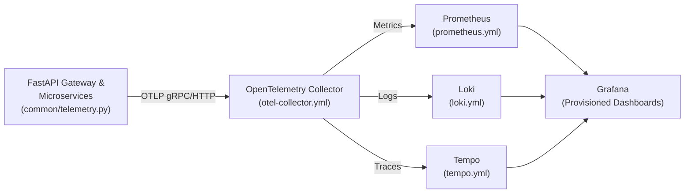

# Deployment, Observability & Testing Guide

This guide covers containerized deployment with Docker Compose, database bootstrap and migration procedures, Temporal worker operations, the OpenTelemetry/Grafana observability stack, and the automated Pytest suite.

---

## 1. Docker Compose Deployment (`docker/`)

The `docker/docker-compose.yml` file orchestrates the complete production/staging topology across dedicated service images:

| Container / Dockerfile | Role |
| :--- | :--- |
| `docker/client/Dockerfile` | Multi-stage Node/Vite build served by Nginx (`client/nginx.conf`). |
| `docker/server/Dockerfile` | Main FastAPI API Gateway (`server/app.py`). |
| `docker/chat/Dockerfile` | Chat & Multi-Agent Orchestration microservice (`services/chat/`). |
| `docker/rag/Dockerfile` | Hybrid Vector + Graph RAG microservice (`services/rag/`). |
| `docker/services/Dockerfile` | Ingestion (`md_maker`, `md_ingestor`), Authentication, and Temporal workers. |
| **Infrastructure Services** | PostgreSQL, Neo4j, S3-compatible Object Storage, Temporal Server, and the Observability Stack. |

### Deployment Steps
1. Copy `server/config/secrets.env.example` to `server/config/secrets.env`. This is the shared environment file for Docker Compose and local application runs.
2. Build and start the stack:
   ```bash
   docker compose --env-file server/config/secrets.env -f docker/docker-compose.yml up -d --build
   ```
3. Initialize the PostgreSQL schema using `docker/server/DB_initialization.py`:
   ```bash
   docker compose --env-file server/config/secrets.env -f docker/docker-compose.yml exec server python /app/DB_initialization.py
   ```
4. Provision an initial administrator user:
   ```bash
   docker compose --env-file server/config/secrets.env -f docker/docker-compose.yml exec server python scripts/create_user.py
   ```

---

## 2. Legacy Elasticsearch to PostgreSQL Migration

For deployments upgrading from earlier Elasticsearch-backed versions of the platform, `server/scripts/migrate_elasticsearch_to_postgres.py` provides an automated, idempotent migration utility:
- Extracts historical users, chat sessions, messages, feedback records, and token usage logs from Elasticsearch (`common/connectors/elastic/`).
- Transforms and loads records into the normalized PostgreSQL schema (`common/connectors/postgres/models.py`).
- Verified by `server/tests/test_postgres_migration.py` and `server/tests/test_postgres_repositories.py`.

---

## 3. Temporal Durable Workers (`services/temporal/`)

Temporal decouples long-running ingestion and multi-agent research workflows from synchronous HTTP request lifecycles:
- **Worker Process (`worker.py`)**: Polls task queues and executes deterministic `workflows.py` and I/O `activities.py`.
- **Client Integration (`client.py`)**: Used by `api/ingest.py` and `services/chat/temporal.py` to start workflows, query status, and send cancellation signals.
- **Configuration Validation**: Verified by `server/tests/test_temporal_config.py`.

---

## 4. Full-Stack Observability (`docker/observability/`)

Every FastAPI service and worker is instrumented via `server/src/common/telemetry.py` using OpenTelemetry (`OTLP`), exporting metrics, structured logs, and distributed traces to the observability stack:



### Pre-Provisioned Grafana Dashboards (`docker/observability/grafana/dashboards/`)
1. **`ask-microservices.json` — Microservices Health & Latency**:
   - Request throughput (RPS), HTTP status distributions, p50/p95/p99 latencies across Gateway, Auth, Chat, RAG, MD Maker, and MD Ingestor.
2. **`ask-runtime.json` — Runtime & Agent Execution**:
   - Distributed trace waterfalls from Tempo showing time spent in Guardrails, VectorRAG, GraphRAG, Reranker, MCP tools, and individual agents.
3. **`ask-token-usage.json` — LLM Token & Cost Analytics**:
   - Prompt vs. completion token rates by model, agent, and user/tenant, supporting capacity planning and cost attribution.

---

## 5. Automated Testing Suite (`server/tests/`)

The backend includes a comprehensive **Pytest** suite validating core infrastructure, safety guardrails, retrieval filters, and service contracts:

| Test File | Verification Scope |
| :--- | :--- |
| `test_service_layout.py` | Enforces standardized microservice directory and module conventions. |
| `test_microservices_orchestration.py` | Validates inter-service communication envelopes and orchestration flows. |
| `test_settings.py` | Verifies YAML configuration loading and Pydantic validation in `config/settings.py`. |
| `test_authentication_hashing.py` | Tests password hashing, salting, and credential verification. |
| `test_pii_redactor.py` | Validates PII detection and redaction masks across diverse text inputs. |
| `test_nemo_guardrails.py` | Tests input/output guardrail enforcement and policy blocking. |
| `test_retriever_filters.py` | Verifies metadata and RBAC filter compilation for Vector and Graph RAG. |
| `test_mcp_tools.py` | Tests Model Context Protocol tool registration, schema validation, and execution. |
| `test_huggingface_tokenizer.py` | Validates local/HuggingFace tokenizer loading and token counting accuracy. |
| `test_postgres_repositories.py` | Integration tests for PostgreSQL chat, user, token, and feedback repositories. |
| `test_postgres_migration.py` | Verifies Elasticsearch-to-PostgreSQL data migration integrity. |
| `test_temporal_config.py` | Validates Temporal client, task queue, and worker configuration. |
| `test_telemetry.py` & `test_fastapi_metrics.py` | Verifies OpenTelemetry span emission and Prometheus `/metrics` endpoints. |

### Running the Test Suite
```bash
cd server
uv run pytest -v
```