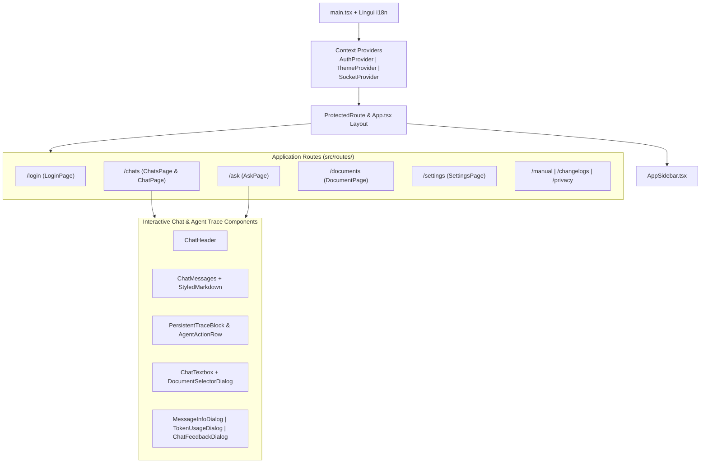

# Frontend Architecture, i18n & White-Label Theming

The **`client/`** application is a modern Single-Page Application (SPA) built with **React**, **TypeScript**, **Vite**, **Tailwind CSS**, and **Shadcn/Radix UI**, engineered to support real-time multi-agent trace visualization, multi-language localization, and multi-tenant white-label deployments.

---

## Frontend Application Architecture

---

## Core Modules & Component Directory

### 1. Context Providers (`client/src/components/providers/`)
- **`AuthProvider.tsx`**: Manages authenticated user session state, JWT persistence, login/logout lifecycle, and user profile hydration (`UserProfileDialog.tsx`).
- **`ProtectedRoute.tsx`**: Guards private application routes (`/ask`, `/chats`, `/documents`, `/settings`), redirecting unauthenticated users to `/login`.
- **`SocketProvider.tsx`**: Establishes and auto-reconnects the WebSocket connection for streaming LLM tokens, live `AgentAction` events, and background ingestion status updates.
- **`ThemeProvider.tsx`**: Controls light/dark/system theme modes and applies tenant-specific CSS custom properties.

### 2. Multi-Agent & Chat Experience (`client/src/components/sections/`)
- **`ChatMessages.tsx` & `styled-markdown.tsx`**: Renders rich Markdown responses with syntax-highlighted code blocks, LaTeX math notation, structured tables, and interactive inline citations.
- **`PersistentTraceBlock.tsx` & `AgentActionRow.tsx`**: Real-time collapsible execution inspector showing which agents (`ResearchAgent`, `AnswerAgent`, `TicketAgent`, etc.) and MCP tools were invoked, their execution durations, and intermediate reasoning steps.
- **`ChatDocuments.tsx` & `DocumentSelectorDialog.tsx`**: Enables users to attach documents to a conversation or activate **Focus Mode** to restrict RAG retrieval to chosen files.
- **`document-viewer.tsx` & `pdf-viewer.tsx`**: Built-in document and PDF previewer powered by `pdf.worker.min`, allowing users to inspect cited pages directly inside the app.
- **`TokenUsageDialog.tsx` & `lib/tokens/forecast.ts`**: Visualizes per-message and historical token consumption alongside predictive usage forecasting.
- **`ChatFeedbackDialog.tsx` & `MessageInfoDialog.tsx`**: Captures user quality ratings and exposes detailed message telemetry (model name, latency, token breakdown, trace ID).

### 3. Typed API Layer (`client/src/api/`)
- `apps.ts`: Tenant/application configuration metadata.
- `chat.ts`: Conversation CRUD, message submission, and feedback endpoints.
- `document.ts`: Document upload (`styled-dropzone.tsx`), listing (`DocumentsTableCard.tsx`), and deletion.
- `featureFlags.ts`: Dynamic feature toggles (`useFeatureFlags.ts`) controlling experimental agents, GraphRAG visibility, or SharePoint sync UI.
- `model.ts`: Available LLM/agent profile discovery.
- `usage.ts`: Token usage metrics and forecasting queries.

---

## Internationalization (i18n) with Lingui

The client supports full multi-language localization configured in `client/lingui.config.js` and `client/src/i18n.ts`:
- **Supported Locales**:
  - `en` — English (`client/src/locales/en/messages.po`)
  - `it` — Italian (`client/src/locales/it/messages.po`)
  - `zh` — Chinese (`client/src/locales/zh/messages.po`)
- **Localized In-App Documentation (`client/src/docs/`)**:
  - User Manuals: `manual.en.md`, `manual.it.md`, `manual.zh.md` (`ManualPage.tsx`)
  - Changelogs: `changelog.en.md`, `changelog.it.md`, `changelog.zh.md` (`ChangelogsPage.tsx`)
  - Privacy Policies: `privacy.en.md`, `privacy.it.md`, `privacy.zh.md` (`PrivacyPage.tsx`)

---

## Multi-Tenant White-Label Architecture (`client/config/`)

`qa-multiagents-rag` supports white-label brand builds out of the box via `client/config/`. Each tenant directory encapsulates brand-specific environment variables, Nginx routing rules, CSS design tokens, and vector logos:

| Tenant Profile | Directory | Customizations Included |
| :--- | :--- | :--- |
| **Default** | `client/config/default/` | `.env`, `nginx.conf`, `public/icon.svg`, `public/logo.svg`, `src/index.css` |
| **Carraro** | `client/config/carraro/` | `.env`, `nginx.conf`, `public/icon.svg`, `public/logo.svg`, `src/index.css` |
| **Mirai** | `client/config/mirai/` | `.env`, `nginx.conf`, `public/icon.svg`, `public/logo.svg`, `src/index.css` |
| **Necto** | `client/config/necto/` | `.env`, `nginx.conf`, `public/icon.svg`, `public/logo.svg`, `src/index.css` |

### Building a Tenant-Specific Frontend Bundle
During CI/CD or Docker image builds (`docker/client/Dockerfile`), selecting a tenant profile copies the corresponding `.env`, `nginx.conf`, `public/{icon,logo}.svg`, and `src/index.css` into the `client/` root prior to `vite build`, producing a fully branded static bundle served by Nginx.