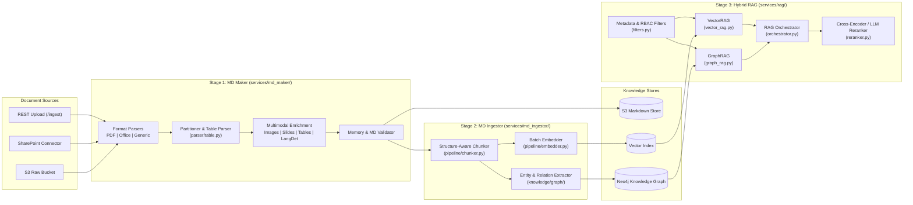

# Hybrid RAG Engine & Document Ingestion Pipeline

`ai-multiagents-assistant` implements a **two-stage decoupled ingestion pipeline** (`md_maker` $\rightarrow$ `md_ingestor`) paired with a **Hybrid Retrieval-Augmented Generation (`rag`) service** that fuses dense vector similarity search with Neo4j Knowledge Graph traversal and neural/LLM reranking.

---

## End-to-End Ingestion & Retrieval Architecture

---

## Stage 1: Document Conversion (`services/md_maker/`)

The **`md_maker`** microservice converts heterogeneous enterprise files into clean, self-contained, semantically enriched Markdown documents.

### 1. Multi-Format Parsers (`md_maker/parser/`)
- **`pdf.py`**: Extracts text blocks, layout coordinates, embedded images, and multi-column structures from PDF documents.
- **`office.py`**: Parses Microsoft Office formats (`.docx`, `.pptx`, `.xlsx`), preserving slide boundaries, speaker notes, sheet names, and document hierarchy.
- **`generic.py`**: Handles Markdown, plain text, CSV, HTML, and structured text files.

### 2. Structural Partitioning & Table Enrichment
- **`partitioner.py`**: Splits raw parsed elements into typed blocks (Headings, Narrative Text, Tables, Figures, Slides).
- **`common/document_processing/parser/table.py`**: Reconstructs complex tables into valid Markdown tables and invokes `common/document_processing/services/llm_service.py` with `prompts/table_descr.md` to generate a natural-language semantic summary of each table's contents and metrics.

### 3. Multimodal & Linguistic Enrichment
- **Image Description (`prompts/img_descr.md`)**: Vision-Language Models (VLMs) describe charts, diagrams, schematics, and screenshots embedded in PDFs/documents so visual knowledge becomes searchable via text and vector queries.
- **Slide Description (`prompts/slide_descr.md`)**: Synthesizes slide visuals + bullet points + speaker notes into cohesive slide-level summaries.
- **Language Detection (`utils/language_detector.py` & `prompts/lang_det.md`)**: Tags each document and section with ISO language codes (e.g., `en`, `it`, `zh`) for downstream filtering and tokenizer selection.
- **Validation (`memory/manager.py` & `memory/validator.py`)**: Ensures generated Markdown conforms to `common/schema/documents.py` before persisting to S3 (`common/connectors/s3/manager.py`).

---

## Stage 2: Chunking & Dual Indexing (`services/md_ingestor/`)

The **`md_ingestor`** microservice consumes validated Markdown from `md_maker` (directly via HTTP or orchestrated asynchronously via Temporal `activities.py`).

1. **Structure-Aware Chunking (`pipeline/chunker.py`)**:
   - Respects Markdown heading hierarchies (`#`, `##`, `###`), code fences, and table boundaries so tables and semantic sections are not arbitrarily severed mid-row.
   - Attaches rich provenance metadata to every chunk: `document_id`, `filename`, `page_number`, `section_title`, `language`, `source_type` (S3/SharePoint/Upload), and access-control tags.
2. **Dense Vector Embedding (`pipeline/embedder.py`)**:
   - Computes dense vector representations using the configured embedding model in `models.yaml` and `common/models/manager.py`.
3. **Knowledge Graph Extraction & Dual Persistence (`pipeline/ingestor.py` & `src/knowledge/graph/`)**:
   - Extracts domain entities (`entities.py`, `schema/knowledge_graph.py`) and semantic relationships (`MENTIONS`, `PART_OF`, `RELATES_TO`, `AUTHORED_BY`).
   - Upserts nodes and edges into **Neo4j** via `knowledge/graph/manager.py` and `common/connectors/neo4j/manager.py`.
   - Upserts chunk vectors and metadata payloads into the **Vector Store** via `knowledge/vector/manager.py`.

---

## Stage 3: Hybrid RAG Retrieval (`services/rag/`)

When a user or agent submits a query, `rag/app.py` delegates to `rag/orchestrator.py`, which coordinates four specialized components:

### 1. Pre-Retrieval Metadata & Security Filtering (`filters.py`)
- Translates user RBAC permissions, selected document IDs (from `Focus` workflow), date ranges, and language preferences into backend-native filter predicates for both the Vector Store and Neo4j.
- Verified by `server/tests/test_retriever_filters.py`.

### 2. Dense Vector Retrieval (`vector_rag.py`)
- Encodes the user query (and optional multi-query expansions) into dense vectors.
- Performs top-$k$ approximate nearest neighbor (ANN) search constrained by `RetrieverFilters`.

### 3. Knowledge Graph Retrieval (`graph_rag.py`)
- Identifies key entities in the user query and matches them against Neo4j nodes (`knowledge/graph/manager.py`).
- Traverses $n$-hop subgraphs to retrieve multi-hop relational facts that pure cosine similarity often misses (e.g., cross-document dependencies, component hierarchies, organizational relationships).

### 4. Fusion & Neural/LLM Reranking (`orchestrator.py` & `reranker.py`)
- Deduplicates and merges candidate chunks from `VectorRAG` and `GraphRAG` using Reciprocal Rank Fusion (RRF) or weighted score normalization.
- Passes the merged top-$N$ candidates through `reranker.py` (Cross-Encoder or LLM relevance scorer) to select the highest-precision top-$k$ context passages returned to `ResearchAgent` and `AnswerAgent`.
