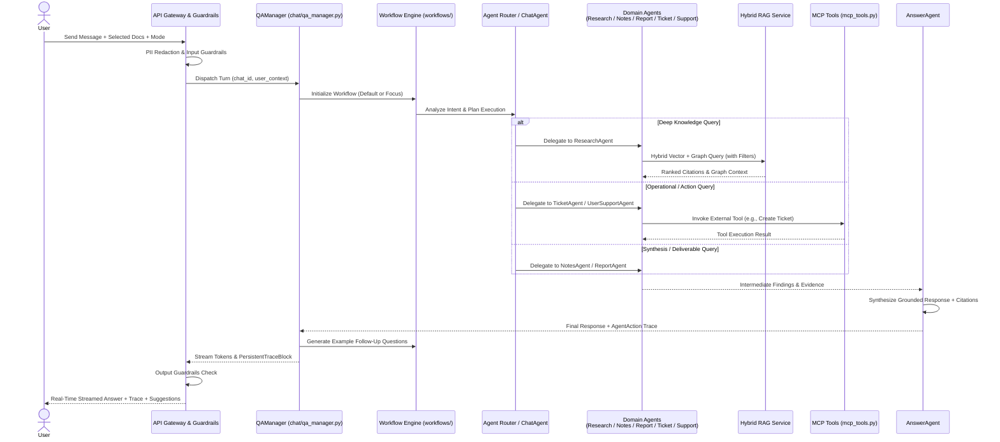

# Multi-Agent Orchestration, MCP Tools & Workflows

The conversational intelligence of **`qa-multiagents-rag`** lives inside `server/src/services/chat/`. Rather than relying on a single monolithic prompt, the platform decomposes user requests across **specialized domain agents**, **structured execution workflows**, and **Model Context Protocol (MCP) tools**.

---

## Multi-Agent Execution Flow

---

## Agent Architecture (`server/src/services/chat/agents/`)

### Base Agent (`base_agent.py`)
All agents inherit from `BaseAgent`, which provides:
- **Standardized Lifecycle**: `plan()`, `execute()`, and `stream()` hooks.
- **Telemetry & Action Emission**: Emits structured `AgentAction` events (mapped to `client/src/lib/types/AgentAction.ts`) so the frontend `AgentActionRow` and `PersistentTraceBlock` components can render step-by-step reasoning in real time.
- **Token & Cost Accounting**: Tracks prompt and completion tokens per agent invocation via `common/models/tokenizer.py` and persists usage to PostgreSQL (`common/connectors/postgres/token.py`).
- **Prompt Binding**: Dynamically resolves agent-specific system instructions from `common/prompt_manager.py`.

### Catalog of Specialized Agents

| Agent | Module | Primary Responsibility | Key Integrations |
| :--- | :--- | :--- | :--- |
| **Chat Agent** | `chat_agent.py` | Handles general conversational turns, intent classification, lightweight follow-ups, and delegation to specialist agents. | `LLMManager`, `ChatHistory` |
| **Research Agent** | `research_agent.py` | Performs multi-step query decomposition, iterative retrieval, and cross-document synthesis for complex analytical questions. | `Hybrid RAG Service`, `RetrieverFilters` |
| **Answer Agent** | `answer_agent.py` | Acts as the final synthesis and grounding stage—merging retrieved chunks, graph facts, and tool outputs into a coherent, citation-backed answer. | `PromptManager`, `LLMManager` |
| **Notes Agent** | `notes_agent.py` | Extracts structured bullet points, meeting minutes, key takeaways, and executive summaries from conversations or attached documents. | `ChatHistory`, `DocumentSchema` |
| **Report Agent** | `report_agent.py` | Generates formal, multi-section structured reports (Markdown tables, executive summaries, findings, recommendations) from retrieved corpus evidence. | `Hybrid RAG Service`, `LLMManager` |
| **Ticket Agent** | `ticket_agent.py` | Automates IT/enterprise support ticket creation, triage, classification, and status lookups based on user issues and knowledge base procedures. | `tickets.yaml`, `MCP Tools` |
| **User Support Agent** | `usersupport_agent.py` | Provides guided troubleshooting, onboarding assistance, and system manual Q&A tailored to end-user workflows. | `Hybrid RAG Service`, `Manual Docs` |

---

## Execution Workflows (`server/src/services/chat/workflows/`)

Workflows define the deterministic or semi-deterministic state machines governing how agents collaborate during a session:

1. **Base Workflow (`base.py`)**:
   - Defines the core execution context, state transitions, cancellation signals, and step-level error recovery.
   - Records execution spans in OpenTelemetry (`common/telemetry.py`) for visualization in Tempo and Grafana (`ask-runtime.json`).
2. **Focus Workflow (`focus.py`)**:
   - Constrains agent reasoning and retrieval strictly to a user-selected subset of documents (`DocumentSelectorDialog.tsx` in the UI) or a specific domain scope.
   - Prevents hallucination from out-of-scope corpus documents by injecting strict `RetrieverFilters` into every sub-agent call.
3. **Example Questions Workflow (`example_questions.py`)**:
   - Runs asynchronously or post-answer to analyze the conversation history and retrieved context, generating 3–4 contextually relevant follow-up questions displayed in the chat UI.

---

## Model Context Protocol (`mcp_tools.py`)

`server/src/services/chat/mcp_tools.py` implements an extensible **Model Context Protocol (MCP)** tool layer that allows agents to safely interact with external APIs and internal services:

- **Schema-Validated Tool Definitions**: Every MCP tool exposes typed input/output Pydantic schemas so LLMs generate valid JSON tool arguments.
- **Sandboxed Execution**: Enforces timeouts, permission checks against the authenticated user's JWT claims, and structured audit logging.
- **Trace Visibility**: Every MCP tool invocation and response payload is captured as an `AgentAction` step in the conversation trace (`MessageInfoDialog.tsx` / `PersistentTraceBlock.tsx`).

---

## Durable Chat Execution with Temporal (`chat/temporal.py`)

For long-running multi-agent tasks (such as generating comprehensive reports across dozens of documents), `chat/temporal.py` offloads execution to the Temporal cluster (`server/src/services/temporal/`):
- Prevents HTTP gateway timeouts.
- Survives worker restarts without losing intermediate agent research state.
- Publishes progress updates back to the client via the real-time socket channel.