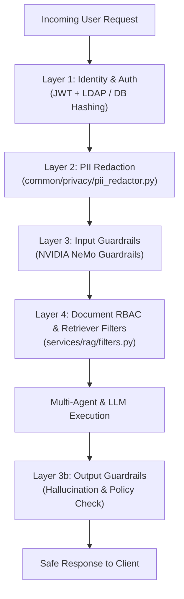

# Security, Privacy, PII Redaction & Guardrails

`ai-multiagents-assistant` is built for regulated enterprise environments where data confidentiality, prompt injection defense, and strict access controls are mandatory. Security controls are enforced across four concentric layers.

---

## Defense-in-Depth Architecture

---

## 1. Identity & Authentication (`services/authentication/`)

- **Dual-Mode Authentication (`manager.py`)**:
  - **LDAP / Active Directory (`ldap.py`)**: Authenticates corporate users against enterprise directory servers and maps LDAP security groups to application roles defined in `server/config/users.yaml`.
  - **Local Database Auth (`database.py` & `hashing.py`)**: Supports standalone deployments with salted, cryptographically strong password hashes (validated by `server/tests/test_authentication_hashing.py`).
- **Stateless JWT Session Management (`jwt_manager.py`)**:
  - Issues signed tokens containing `sub` (user ID), `roles`, and expiration claims (`exp`).
  - Frontend `AuthProvider.tsx` and `ProtectedRoute.tsx` manage token storage, automatic session validation, and route protection.

---

## 2. Automated PII Redaction (`common/privacy/pii_redactor.py`)

Before user prompts are sent to external or internal LLMs—or persisted in telemetry/logs—`pii_redactor.py` scans and sanitizes Personally Identifiable Information (PII):

- **Detected Entities**: Email addresses, phone numbers, Social Security / national ID numbers, credit card numbers, IP addresses, and custom enterprise identifiers.
- **Redaction Strategy**: Replaces sensitive spans with deterministic typed placeholders (e.g., `[REDACTED_EMAIL]`, `[REDACTED_PHONE]`, `[REDACTED_SSN]`) so downstream agents preserve semantic sentence structure without leaking raw personal data.
- **Verification**: Covered by unit tests in `server/tests/test_pii_redactor.py`.

---

## 3. Programmable AI Safety with NVIDIA NeMo Guardrails (`common/privacy/nemo_guardrails.py`)

The platform integrates **NVIDIA NeMo Guardrails**, configured declaratively via `server/config/guardrails/config.yml`:

- **Input Rails**:
  - **Jailbreak & Prompt Injection Detection**: Blocks adversarial attempts to override system prompts or extract internal instructions.
  - **Topical Boundaries**: Ensures conversations remain within authorized enterprise domains and rejects out-of-policy requests.
- **Output Rails**:
  - **Toxicity & Compliance Filtering**: Prevents generation of harmful, biased, or non-compliant content.
  - **Grounding & Factuality Verification**: Ensures `AnswerAgent` responses remain faithful to retrieved RAG context rather than fabricating unsupported claims.
- **Verification**: Covered by `server/tests/test_nemo_guardrails.py`.

---

## 4. Document-Level RBAC & Corpus Isolation

- **Metadata-Driven Access Control (`services/rag/filters.py`)**:
  - Every ingested document chunk in the Vector Store and node in Neo4j carries ownership and role metadata (`owner_id`, `allowed_roles`, `tenant_id`).
  - At query time, `RetrieverFilters` injects mandatory access predicates into both `VectorRAG` and `GraphRAG`, ensuring users can never retrieve or infer knowledge from unauthorized documents.
- **Focus Mode Isolation (`services/chat/workflows/focus.py`)**:
  - When a user selects specific documents in `DocumentSelectorDialog.tsx`, retrieval is hard-scoped strictly to those document IDs.

---

## 5. Secrets & Credential Governance

- **No Hardcoded Secrets**: API keys, database passwords, S3 secret keys, Neo4j credentials, and JWT signing secrets are loaded from the shared, git-ignored `server/config/secrets.env` or container environment variables.
- **Service Account Credentials**: External cloud credentials (such as `server/config/google_credentials.json`) are isolated in `server/config/` and excluded from container build contexts via `.dockerignore`.
- **In-App Privacy Documentation**: Localized GDPR/data-privacy notices are bundled directly in the client (`client/src/docs/privacy.en.md`, `privacy.it.md`, `privacy.zh.md`) and accessible via `/privacy` (`PrivacyPage.tsx`).
