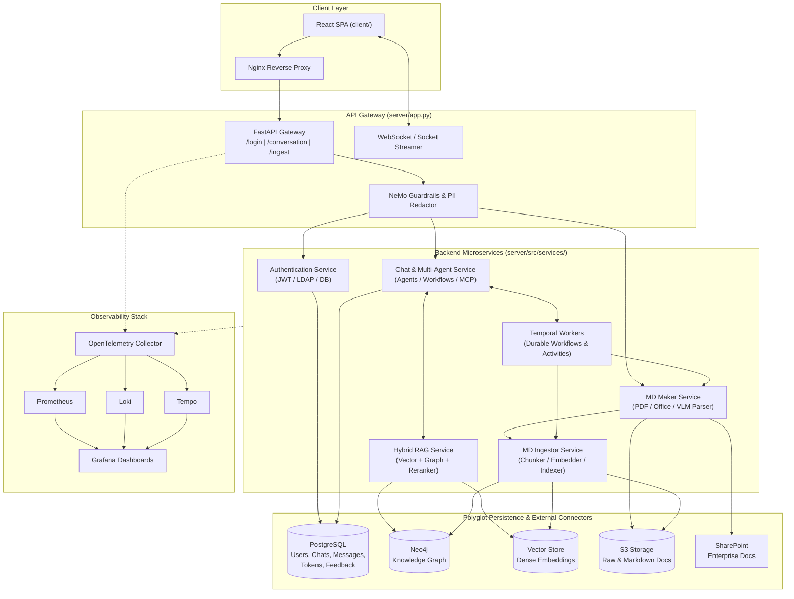

# System & Microservices Architecture

`qa-multiagents-rag` is designed as a modular, service-oriented architecture (SOA) where an API Gateway coordinates specialized backend microservices, durable Temporal workers, and polyglot persistence stores.

---

## Architectural Topology

---

## Core Microservices Breakdown

All microservices follow a standardized layout enforced by `server/src/common/microservices/` (`base.py` and `schemas.py`) and verified by `server/tests/test_service_layout.py` and `server/tests/test_microservices_orchestration.py`.

### 1. API Gateway (`server/app.py`)
- **Role**: Unified external entry point for the React client and external API consumers.
- **Responsibilities**:
  - Mounts public routers (`server/api/login.py`, `server/api/conversation.py`, `server/api/ingest.py`).
  - Enforces request validation, CORS, authentication middleware, and rate/guardrail policies.
  - Exposes Prometheus `/metrics` endpoints and OpenTelemetry trace propagation headers.

### 2. Authentication Service (`server/src/services/authentication/`)
- **Role**: Identity verification, directory federation, and token lifecycle management.
- **Key Modules**:
  - `ldap.py`: Enterprise Active Directory / LDAP bind and group lookup.
  - `database.py` & `hashing.py`: Local PostgreSQL credential storage with salted cryptographic password hashing.
  - `jwt_manager.py`: Issuance, verification, and expiration handling of stateless JSON Web Tokens (JWT).
  - `client.py`: Typed internal HTTP client used by the Gateway and sibling services to validate tokens.

### 3. Chat & Multi-Agent Service (`server/src/services/chat/`)
- **Role**: Conversational state management, multi-agent routing, MCP tool invocation, and streaming response orchestration.
- **Key Modules**:
  - `chat_manager.py` & `chat_history.py`: Conversation lifecycle, message persistence, and context window trimming.
  - `qa_manager.py`: Coordinates Q&A turns between user queries, guardrails, RAG retrieval, and specialized agents.
  - `agents/`: Specialized autonomous/semi-autonomous agents (`chat`, `research`, `answer`, `notes`, `report`, `ticket`, `usersupport`).
  - `workflows/`: Structured multi-step reasoning flows (`base.py`, `focus.py`, `example_questions.py`).
  - `mcp_tools.py`: Model Context Protocol tool registry and execution sandbox.
  - `temporal.py`: Dispatches long-running or asynchronous chat workflows to Temporal.

### 4. Hybrid RAG Service (`server/src/services/rag/`)
- **Role**: High-precision knowledge retrieval combining semantic vector search and graph relational reasoning.
- **Key Modules**:
  - `orchestrator.py`: Executes parallel or sequential retrieval across vector and graph backends and fuses candidate sets.
  - `vector_rag.py`: Dense embedding similarity search.
  - `graph_rag.py`: Entity extraction and multi-hop Cypher traversal over Neo4j.
  - `filters.py`: Metadata, tenant, and document-level access control filtering.
  - `reranker.py`: Cross-encoder / LLM-based relevance scoring to reorder retrieved passages before synthesis.

### 5. Markdown Maker Service (`server/src/services/md_maker/`)
- **Role**: Multi-format document ingestion, structural partitioning, and multimodal enrichment into clean Markdown.
- **Key Modules**:
  - `parser/pdf.py`, `parser/office.py`, `parser/generic.py`: Format-specific extractors for PDFs, DOCX/PPTX/XLSX, and plain text/HTML.
  - `partitioner.py`: Logical document segmentation (headings, paragraphs, tables, embedded images, slides).
  - `utils/language_detector.py`: Automatic language classification.
  - `prompts/`: LLM/VLM prompt templates for describing images (`img_descr.md`), slides (`slide_descr.md`), and language detection (`lang_det.md`).
  - `memory/manager.py` & `validator.py`: Intermediate state tracking and Markdown schema validation.

### 6. Markdown Ingestor Service (`server/src/services/md_ingestor/`)
- **Role**: Transforms normalized Markdown artifacts into searchable vector embeddings and knowledge graph triples.
- **Key Modules**:
  - `pipeline/chunker.py`: Structure-aware semantic text splitting with configurable overlap.
  - `pipeline/embedder.py`: Batch embedding generation via `server/src/common/models/`.
  - `pipeline/ingestor.py`: Atomic writes to the Vector Store, Neo4j Knowledge Graph, and S3 artifact storage.

### 7. Temporal Durable Execution Service (`server/src/services/temporal/`)
- **Role**: Guarantees fault tolerance, retries, and state durability for long-running background operations.
- **Key Modules**:
  - `workflows.py`: Deterministic workflow definitions (e.g., bulk SharePoint/S3 ingestion, multi-step deep research).
  - `activities.py`: Non-deterministic I/O activities calling `md_maker`, `md_ingestor`, and LLM APIs.
  - `worker.py` & `client.py`: Worker polling daemon and workflow submission client.

---

## Shared Foundation (`server/src/common/`)

To prevent code duplication and enforce backend standardization (see `BACKEND_STANDARDIZATION.md`), all microservices share `server/src/common/`:

- **Connectors (`common/connectors/`)**:
  - `postgres/`: SQLAlchemy/asyncpg repositories for `chat`, `user`, `token`, and `feedback` (`models.py`, `base.py`).
  - `neo4j/manager.py`: Connection pooling and Cypher query execution.
  - `s3/manager.py`: Bucket operations for raw uploads and parsed Markdown files.
  - `sharepoint/manager.py`: Microsoft Graph / SharePoint document library synchronization.
  - `elastic/`: Legacy Elasticsearch connectors retained for migration compatibility (`scripts/migrate_elasticsearch_to_postgres.py`).
- **LLM & Model Management (`common/llm/` & `common/models/`)**:
  - `llm/manager.py`: Provider-agnostic chat/completion interface configured via `server/config/models.yaml`.
  - `models/manager.py`, `llama_config.py`, `tokenizer.py`: Local/HuggingFace model loading and accurate token counting.
- **Document Processing Primitives (`common/document_processing/`)**:
  - `parser/table.py` & `prompts/table_descr.md`: Converts complex tabular layouts into structured Markdown + natural-language summaries.
- **Prompt Management (`common/prompt_manager.py`)**:
  - Centralized loader and Jinja/variable renderer backed by `server/config/prompts.yaml`.

---

## Configuration Architecture (`server/config/`)

Runtime behavior is decoupled from code via declarative YAML files in `server/config/` and validated by `server/config/settings.py`:

| Configuration File | Purpose |
| :--- | :--- |
| `system.yaml` | Global environment mode, host/port bindings, CORS, and feature toggles. |
| `microservices.yaml` | Service discovery URLs, timeouts, retry policies, and internal auth headers. |
| `models.yaml` | LLM, VLM, embedding, and reranker model endpoints, temperatures, and token limits. |
| `chat.yaml` | History window sizes, streaming chunk intervals, default agent routing rules. |
| `ingestion.yaml` | Chunk sizes, chunk overlap, supported MIME types, OCR/VLM enrichment flags. |
| `storage.yaml` | S3 bucket names, PostgreSQL pool settings, Neo4j URI, SharePoint site mappings. |
| `tickets.yaml` | External ticketing system integration settings for `TicketAgent`. |
| `users.yaml` | Default roles, RBAC permissions, and LDAP attribute mappings. |
| `prompts.yaml` | System prompts for agents, routers, summarizers, and query rewriters. |
| `guardrails/config.yml` | NVIDIA NeMo Guardrails topical, safety, and jailbreak prevention rules. |